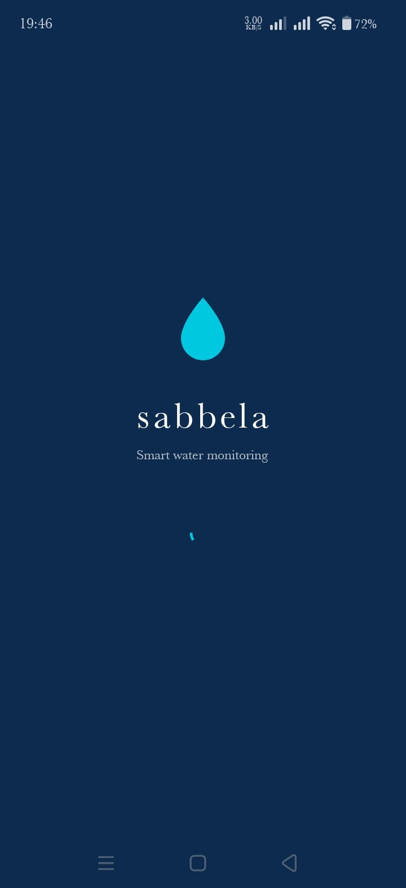
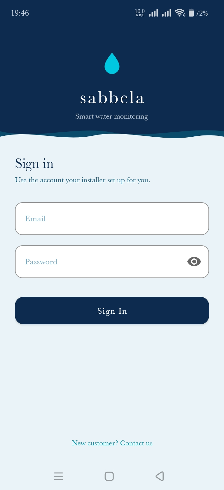
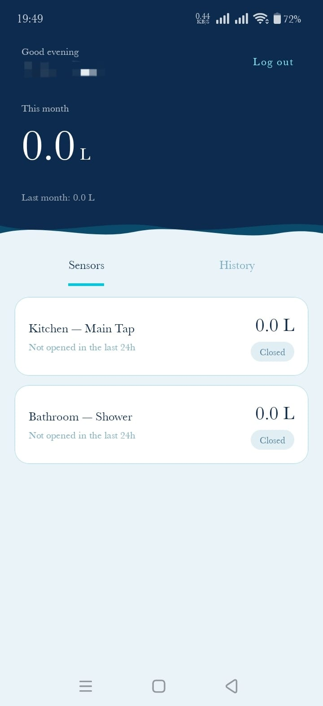
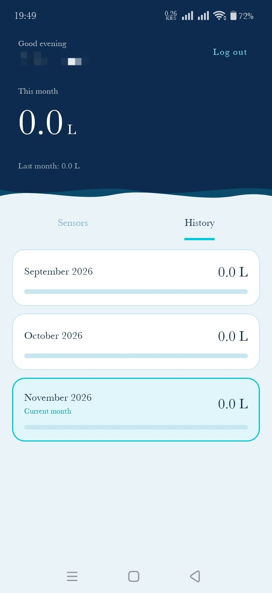
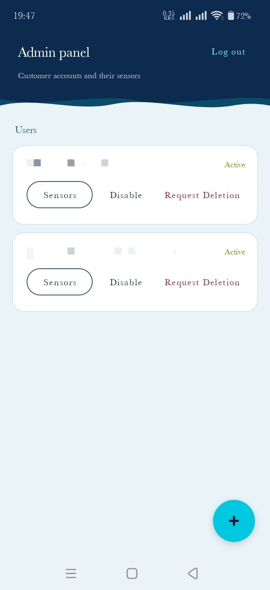
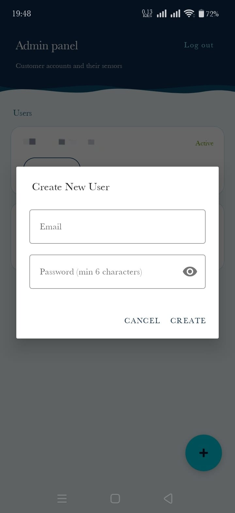
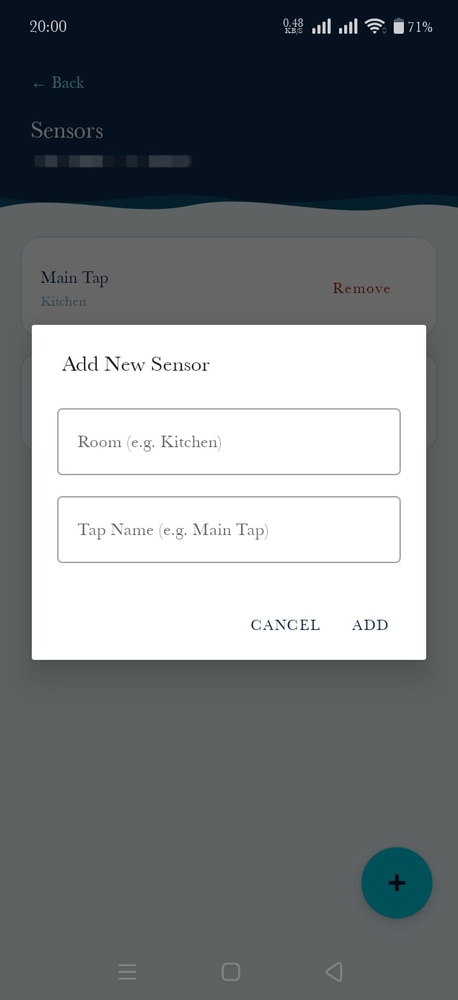
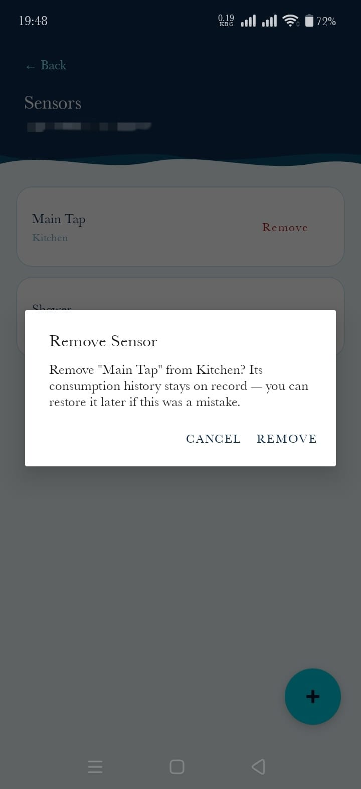
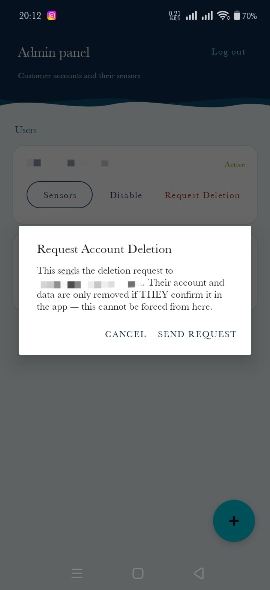

# Sabbela: Smart Home Water Monitoring (Tunisia)

An Android app that lets households monitor their water use tap by tap, with push alerts when something looks wrong.

> **Showcase repository.** It contains screenshots, UI resources and a few sample files. The full source code is private. I'm happy to walk through it in an interview.



## What it does

- Live open/closed state of each tap
- Liters used this month, and monthly history
- Push notifications for taps left open or used unusually long
- Two sides: a **customer** side (sensors, history) and an **admin** side (account creation, sensor creation and removal)

## Architecture (overview)

```
Flow sensors ──▶ ESP32 ──▶ Firebase Realtime Database ──▶ Android app
                                      ▲                        ▲
              Serverless job (every minute) ── push alerts (FCM)
```

## Status

- ✅ Android app in Kotlin: customer and admin sides
- ✅ Firebase Authentication, Realtime Database and Cloud Messaging
- ✅ Serverless backend on Cloudflare Workers
- ⏳ ESP32 firmware and flow sensors: not built yet, installation planned

## Screenshots

### Customer side

| Login | Sensors | History |
|---|---|---|
|  |  |  |

### Admin side

| Home | Create user | Create sensor | Remove sensor | Deletion request |
|---|---|---|---|---|
|  |  |  |  |  |

## What is in this repo

- `images/`: app screenshots
- `ui-samples/`: layouts, drawables, themes, the manifest and a few UI helper classes

## Tools

Kotlin, Android Studio, Firebase (Auth, Realtime Database, Cloud Messaging), Cloudflare Workers

## Author

Mohamed Aziz Farhani, IoT Engineering Student at ISITCom Hammam Sousse
[LinkedIn](https://www.linkedin.com/in/mohamed-aziz-farhani-18540a33a)
